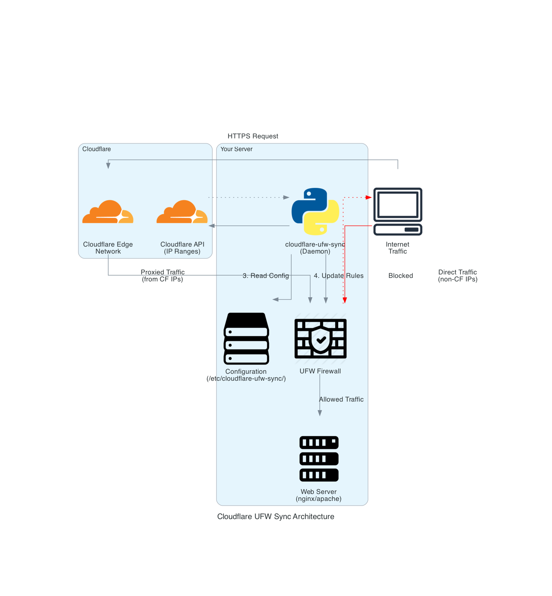

# Cloudflare UFW Sync

[](https://github.com/somethingwithproof/cloudflare-ufw-sync/actions/workflows/tests.yml)
[](https://sonarcloud.io/summary/new_code?id=somethingwithproof_cloudflare-ufw-sync)
[](https://github.com/somethingwithproof/cloudflare-ufw-sync/releases)
[](./pyproject.toml)
[](./LICENSE)
[](https://scorecard.dev/viewer/?uri=github.com/somethingwithproof/cloudflare-ufw-sync)

**Languages:** [English](../../../README.md) · [Deutsch](../de/README.md) · [Español](../es/README.md) · [Français](../fr/README.md) · **Italiano** · [Português (BR)](../pt-BR/README.md) · [Nederlands](../nl/README.md) · [Русский](../ru/README.md) · [Українська](../uk/README.md) · [日本語](../ja/README.md) · [한국어](../ko/README.md) · [简体中文](../zh-CN/README.md) · [繁體中文](../zh-TW/README.md) · [العربية](../ar/README.md) · [हिन्दी](../hi/README.md) · [Polski](../pl/README.md) · [Türkçe](../tr/README.md) · [Svenska](../sv/README.md) · [Tiếng Việt](../vi/README.md) · [Bahasa Indonesia](../id/README.md)

<details><summary>More languages (25 African &amp; Asian locales)</summary>

[Afrikaans](../af-ZA/README.md) · [አማርኛ](../am-ET/README.md) · [العربية (مصر)](../ar-EG/README.md) · [العربية (المغرب)](../ar-MA/README.md) · [বাংলা](../bn/README.md) · [فارسی](../fa/README.md) · [Filipino](../fil/README.md) · [Français (Maroc)](../fr-MA/README.md) · [Français (Sénégal)](../fr-SN/README.md) · [Hausa](../ha-NG/README.md) · [עברית](../he/README.md) · [Igbo](../ig-NG/README.md) · [Malagasy](../mg-MG/README.md) · [मराठी](../mr/README.md) · [Bahasa Melayu](../ms/README.md) · [Kinyarwanda](../rw-RW/README.md) · [Soomaali](../so-SO/README.md) · [Kiswahili](../sw-KE/README.md) · [தமிழ்](../ta/README.md) · [తెలుగు](../te/README.md) · [ไทย](../th/README.md) · [اردو](../ur/README.md) · [isiXhosa](../xh-ZA/README.md) · [Yorùbá](../yo-NG/README.md) · [isiZulu](../zu-ZA/README.md)

</details>

Sincronizzazione degli IP di Cloudflare per UFW.

## Panoramica

`cloudflare-ufw-sync` sincronizza gli intervalli IP di Cloudflare con le regole del tuo firewall UFW (Uncomplicated Firewall). Il sincronizzatore gestisce le proprie regole UFW configurate; la restrizione dell'accesso al server di origine dipende anche dalla policy predefinita e da eventuali altre regole di consenso. La sola sincronizzazione non garantisce che l'accesso diretto all'origine sia bloccato.

## Architettura



## Funzionalità

- 🔄 Sincronizzazione automatica degli intervalli IP di Cloudflare con le regole UFW
- 🔒 Gestione sicura delle regole UFW con controllo appropriato dei permessi
- 🛠️ Supporto per intervalli di indirizzi sia IPv4 che IPv6
- 🔍 Log dettagliati per audit e risoluzione dei problemi
- 🔧 Configurazione personalizzabile
- 🧪 Suite di test

## Installazione

### Dai sorgenti

```bash
git clone https://github.com/somethingwithproof/cloudflare-ufw-sync.git
cd cloudflare-ufw-sync
pip install .
```

## Configurazione

Crea un file di configurazione in `/etc/cloudflare-ufw-sync/config.yml` o `~/.config/cloudflare-ufw-sync/config.yml`:

```yaml
cloudflare:
  api_key: your-api-key  # Optional: Only needed if using authenticated endpoints
  ip_types:
    - v4  # IPv4 addresses
    - v6  # IPv6 addresses

ufw:
  default_policy: deny
  port: 443  # The port to allow access to
  proto: tcp  # Protocol passed to ufw (for example tcp or udp)
  comment: "Cloudflare IP"  # Comment for UFW rules

sync:
  interval: 86400  # Sync interval in seconds (default: 1 day)
```

## Utilizzo

### Riga di comando

```bash
# Run a sync operation
cloudflare-ufw-sync sync

# Run in daemon mode
cloudflare-ufw-sync daemon

# View current status
cloudflare-ufw-sync status
```

### Come servizio

Viene fornito un file di servizio systemd per eseguire la sincronizzazione come servizio:

```bash
sudo cp scripts/cloudflare-ufw-sync.service /etc/systemd/system/
sudo systemctl daemon-reload
sudo systemctl enable cloudflare-ufw-sync
sudo systemctl start cloudflare-ufw-sync
```

## Localizzazione

La guida della CLI, i riepiloghi di stato e i messaggi operativi supportano 45 lingue (`en`, `de`, `es`, `fr`, `it`, `pt-BR`, `nl`, `ru`, `uk`, `ja`, `ko`, `zh-CN`, `zh-TW`, `ar`, `hi`, `pl`, `tr`, `sv`, `vi`, `id`, `af-ZA`, `am-ET`, `ar-EG`, `ar-MA`, `fr-MA`, `fr-SN`, `ha-NG`, `ig-NG`, `mg-MG`, `rw-RW`, `so-SO`, `sw-KE`, `xh-ZA`, `yo-NG`, `zu-ZA`, `bn`, `fa`, `he`, `mr`, `ta`, `te`, `th`, `ur`, `ms`, `fil`) senza dipendenze aggiuntive. La risoluzione controlla `--lang`, poi `LC_ALL`, `LC_MESSAGES` e `LANG`, ripiegando su `en`.

```bash
cloudflare-ufw-sync --lang de status
LANG=fr_FR.UTF-8 cloudflare-ufw-sync --help
```

## Sviluppo

### Test con Docker

Se preferisci un ambiente isolato, puoi compilare ed eseguire l'intera suite di test in Docker.

```bash
# Build the dev image (includes dev dependencies and package in editable mode)
docker build -t cloudflare-ufw-sync:dev .

# Run tests with pytest (quiet mode, stop on first failure)
docker run --rm -t --entrypoint pytest cloudflare-ufw-sync:dev -q --maxfail=1 --disable-warnings
```

Questa è l'esatta configurazione usata in CI e dai manutentori per verificare localmente le modifiche.

### Target Make

Per comodità, alcuni target Make rispecchiano il workflow Docker:

```bash
# Build the dev image
make docker-build

# Run the test suite inside the container
make docker-test

# Run tox (lint + mypy per tox.ini) inside the container
make docker-tox
```

### Configurazione dell'ambiente

```bash
# Clone the repository
git clone https://github.com/somethingwithproof/cloudflare-ufw-sync.git
cd cloudflare-ufw-sync

# Set up a virtual environment
python -m venv venv
source venv/bin/activate

# Install dev dependencies
pip install -e ".[dev]"
```

### Test e linting con Tox

Il progetto include un file `tox.ini` che configura gli ambienti per test, linting e controllo dei tipi. Questo ti permette di eseguire localmente le stesse verifiche eseguite nella pipeline CI prima di effettuare il commit delle modifiche.

```bash
# Install tox
pip install tox

# Run tests, lint and type checks on supported Python
tox -e py312,lint,mypy

# Run tests on Python 3.12, the minimum supported version
tox -e py312

# Run only linting checks
tox -e lint

# Run only type checking
tox -e mypy

# Format code
tox -e format
```

### Test manuali

Se preferisci eseguire manualmente test e linting:

```bash
# Run tests
pytest

# Run linting
black .
isort .
flake8

# Run type checking
mypy src
```

## Licenza

Questo progetto è rilasciato sotto licenza MIT - consulta il file [LICENSE](../../../LICENSE) per i dettagli.

## Sicurezza

Consulta [SECURITY.md](../../../SECURITY.md) per la policy di sicurezza e per segnalare vulnerabilità.

## Contribuire

I contributi sono benvenuti! Apri pure una Pull Request.
